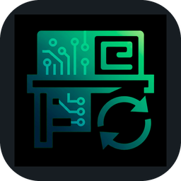
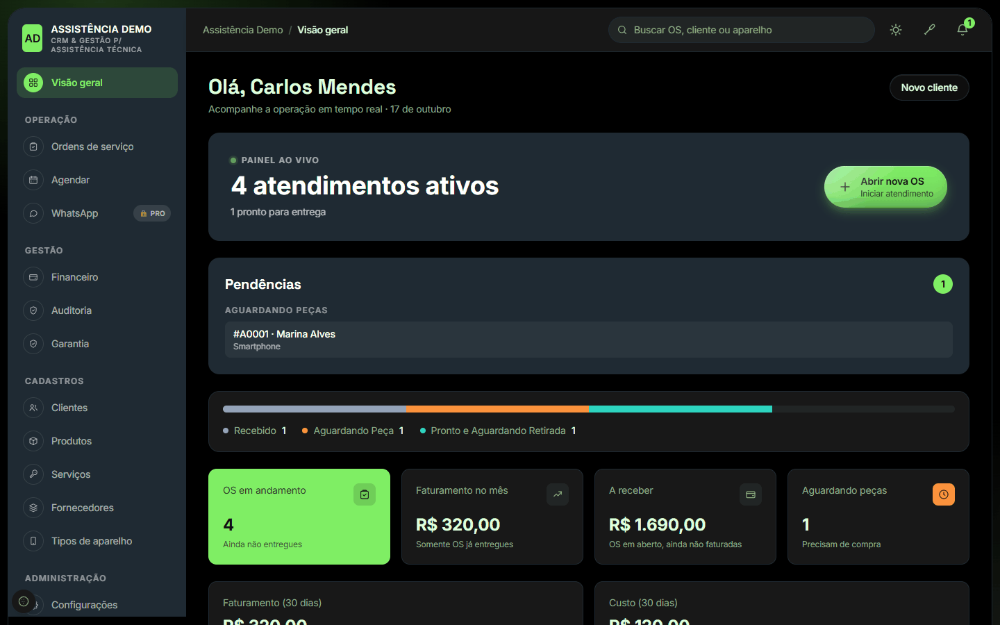
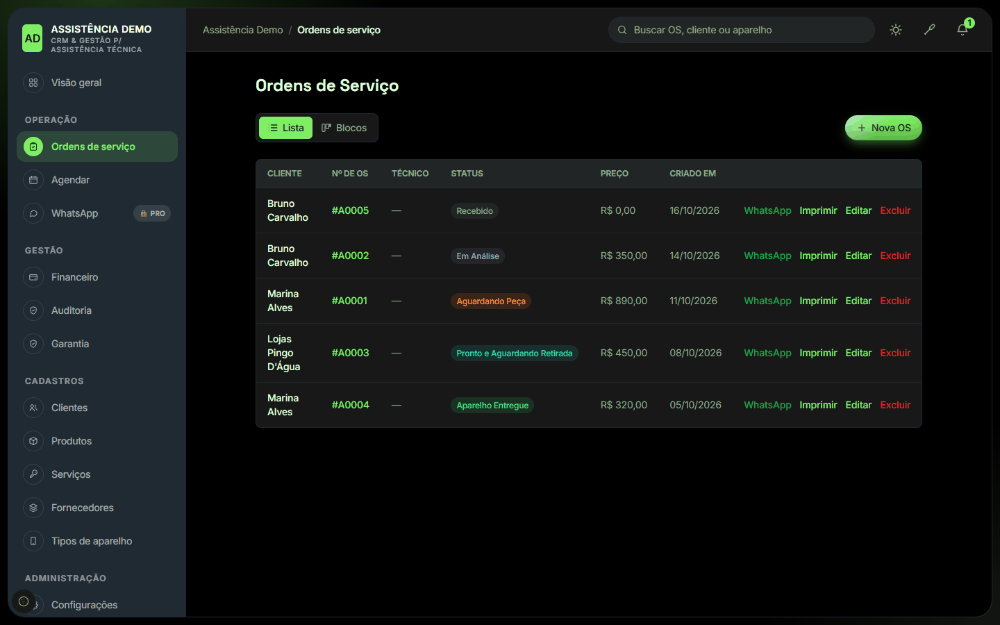
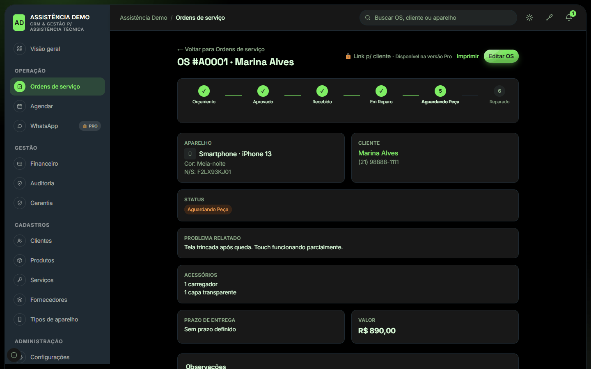
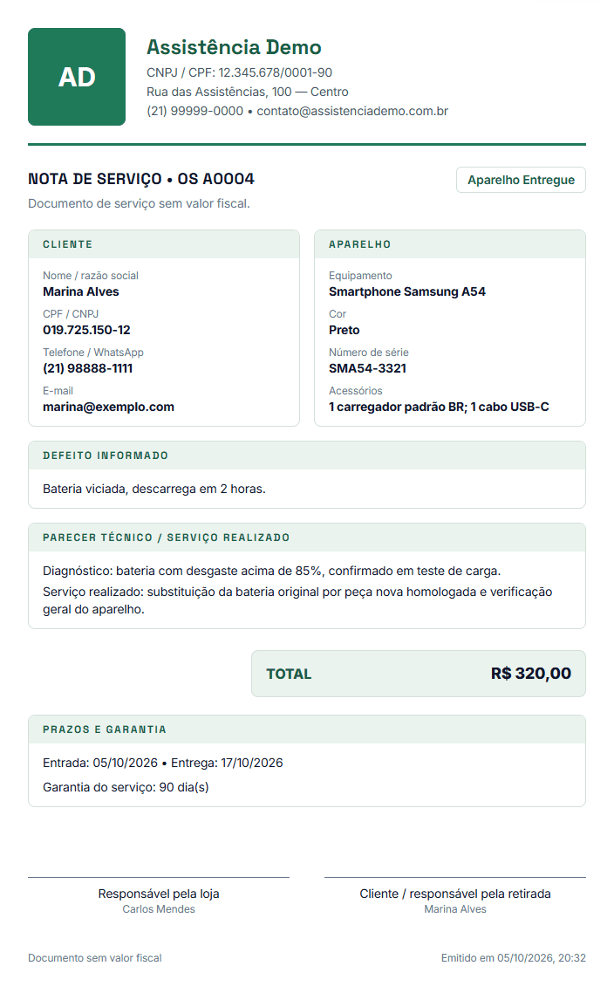
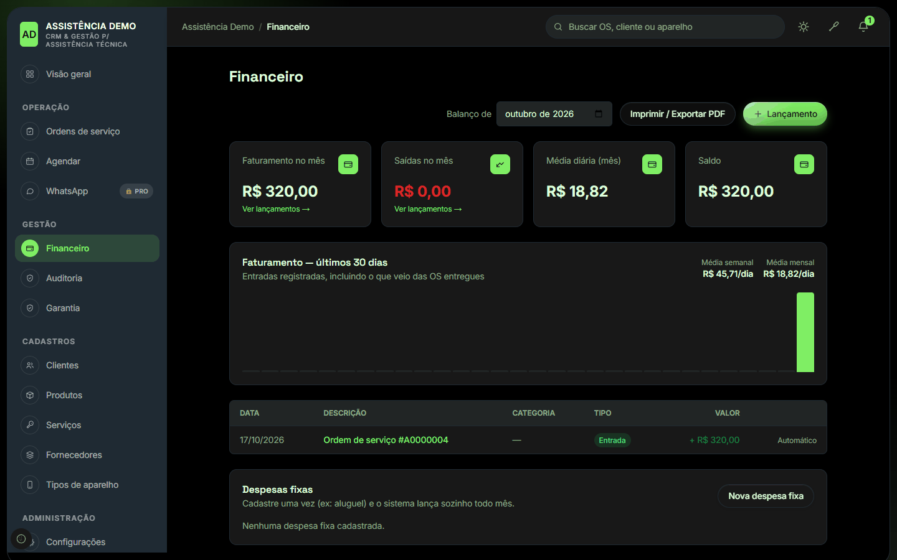
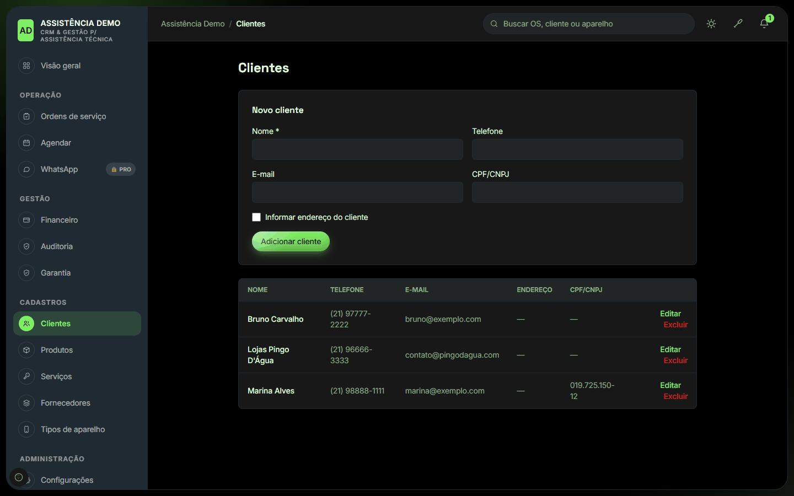
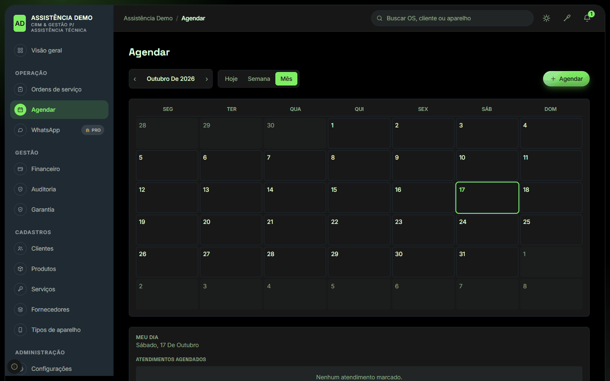
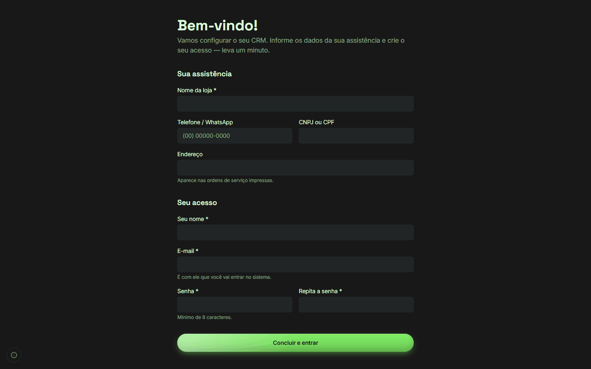

<p align="center">
  
</p>

<h1 align="center">BancadaSync</h1>
<p align="center">🌐 <b><a href="README.md">Ler em português</a></b></p>
<p align="center"><b>From check-in to delivered repair.</b><br>
The management system for repair shops that runs on your own computer. Free.</p>

<p align="center">
  <a href="https://github.com/MeoWDev-MOD/BancadaSync-Download/releases/latest/download/BancadaSync-Setup.exe"><b>⬇️ Download for Windows (85 MB)</b></a>
  &nbsp;·&nbsp;
  <a href="https://techmeow.app/BancadaSync-Download/en/">See the page with the screenshots</a>
</p>

> The program's interface is in Portuguese. The website is also available in [Español](https://techmeow.app/BancadaSync-Download/es/) and [Русский](https://techmeow.app/BancadaSync-Download/ru/).

---

## The problem

In many repair shops the operation lives in a notebook, a spreadsheet and WhatsApp chats:
the device arrives and nobody remembers what came with it, the customer calls asking "is it ready?",
the part was ordered but nobody knows which service order is waiting for it, the warranty is not written
anywhere and, at the end of the month, there is no way to know how much the shop really billed.

BancadaSync organizes that whole cycle in one place: **check-in → quote → repair → delivery → warranty → cash**.

## What it solves

| Day-to-day pain | How BancadaSync solves it |
|---|---|
| "What came with the device?" | The **service order** records customer, device, serial number, accessories and the reported fault right at the counter. |
| "How far along is this repair?" | Every order has a **status** (quote, approved, received, under analysis, waiting for parts, ready, delivered), visible in the list and on the dashboard. |
| "Which order is stuck waiting for parts?" | The **live dashboard** shows the active jobs and the **pending items** (orders waiting for parts, ready for pickup). |
| "The customer says they never signed anything" | **Professional printing of the service order** (service note, not a tax document) with the shop's details, items, total, deadlines, warranty and a signature field. |
| "What was the warranty again?" | **Warranty terms** per type of service, printed together with the order. |
| "How much came in and how much went out?" | **Finances**: what is delivered automatically becomes income; expenses, fixed costs, monthly balance and PDF export. |
| "How much commission do I pay?" | **Commission per technician**, calculated on the delivered repairs. |
| "Where is this customer's history?" | **Customer records** with every order of each one. |
| "Who touched this?" | **Audit log** and **permissions per role** (owner, administrator, clerk, technician, pickup). |
| "What if the internet goes down?" | The data stays **on your computer**. No monthly fee and no cloud needed to work. |

It also includes an appointment calendar, products and stock, services, suppliers and device types.

## Screenshots

<table>
  <tr>
    <td width="50%"><br><sub><b>Live dashboard</b>: active jobs, pending items and the month's numbers.</sub></td>
    <td width="50%"><br><sub><b>Service orders</b>: the status of every device at a glance.</sub></td>
  </tr>
  <tr>
    <td><br><sub><b>Order detail</b>: repair flow, device, customer and amounts.</sub></td>
    <td><br><sub><b>Printed order</b>: service note ready for the customer to sign.</sub></td>
  </tr>
  <tr>
    <td><br><sub><b>Finances</b>: revenue, expenses, monthly balance and fixed costs.</sub></td>
    <td><br><sub><b>Customers</b>: records with each one's history.</sub></td>
  </tr>
  <tr>
    <td><br><sub><b>Calendar</b>: appointments for the day, the week and the month.</sub></td>
    <td><br><sub><b>First access</b>: create your shop and your user in a minute.</sub></td>
  </tr>
</table>

> The screenshots use fictional data (the "Assistência Demo" shop).

## Free and Pro

| | Free | Pro |
|---|:---:|:---:|
| Service orders, printing and warranty | ✅ | ✅ |
| Customers, devices, products, services and suppliers | ✅ | ✅ |
| Finances and commissions | ✅ | ✅ |
| Audit log and permissions per role | ✅ | ✅ |
| Users | up to 3 | unlimited |
| Tracking link for the customer | 🔒 | ✅ |
| Built-in WhatsApp and message templates | 🔒 | ✅ |
| API / N8N integration | 🔒 | ✅ |
| Access on desktop, tablet and phone | 🔒 | ✅ |
| Follow from afar, in real time, when the shop is billing | 🔒 | ✅ |

Pro is activated with the developer: see the contact at the end of this page.

## How to install

1. Download **[BancadaSync-Setup.exe](https://github.com/MeoWDev-MOD/BancadaSync-Download/releases/latest/download/BancadaSync-Setup.exe)**.
2. Double-click it. Windows may show the **"Windows protected your PC"** warning: click **More info** and then **Run anyway** (see the FAQ below).
3. Follow the wizard. **No administrator password needed.**
4. Open **BancadaSync** from the shortcut. The browser opens on the first-access screen: enter the shop's details and create your user and password.

To shut the system down, use **Desligar o BancadaSync** (Shut down BancadaSync) in the Start menu. When you turn the computer on again, just open the shortcut: all your data and logins come back as they were.

**Requirements:** 64-bit Windows 10 or 11 and about 350 MB free.

## Frequently asked questions

**Why does Windows show a warning when installing?**
The installer does not have a paid digital signature yet (a "verified publisher" certificate), so SmartScreen shows "unknown publisher". The file is the same one published here: you can check its integrity with the hash below.

**Where is my data kept?**
On your computer, in `%APPDATA%\CRM Assistencia`. When uninstalling, the program asks whether you want to delete the data (the default is to keep it).

**Do I need internet?**
For day-to-day work, no. Only for the features that depend on it (such as WhatsApp, in the Pro version).

**Can I update over the current version?**
Yes. Run the new installer: it shuts the system down, replaces the files and keeps your data.

**Check the file (SHA-256) of `BancadaSync-Setup.exe` version 1.0.0:**

```
1d10463c9d5ac24ce16623b04e5573c4cbf718de99053cb7d86f108681689fa7
```

In PowerShell: `Get-FileHash .\BancadaSync-Setup.exe -Algorithm SHA256`

## Contact

Developed by **Jefferson Honorio (MeoWDev MOD)**.

- WhatsApp: [+55 21 96654-7296](https://wa.me/5521966547296)
- Instagram: [@TECH_MEOW.OFICIAL](https://www.instagram.com/tech_meow.oficial?cplk=MWp5Z2s2cjNuNG01bg==)
- Website: [Tech MeoW](https://techmeow.app/en/)
- E-mail: vendas.hson@gmail.com

<p align="center"></p>
