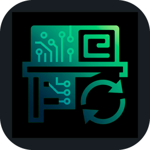
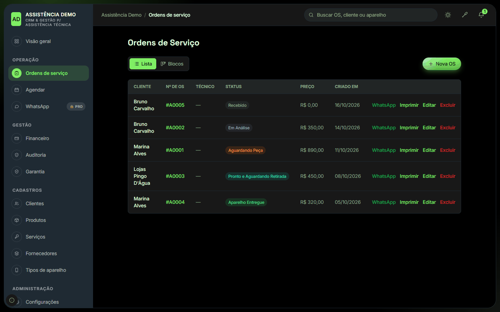
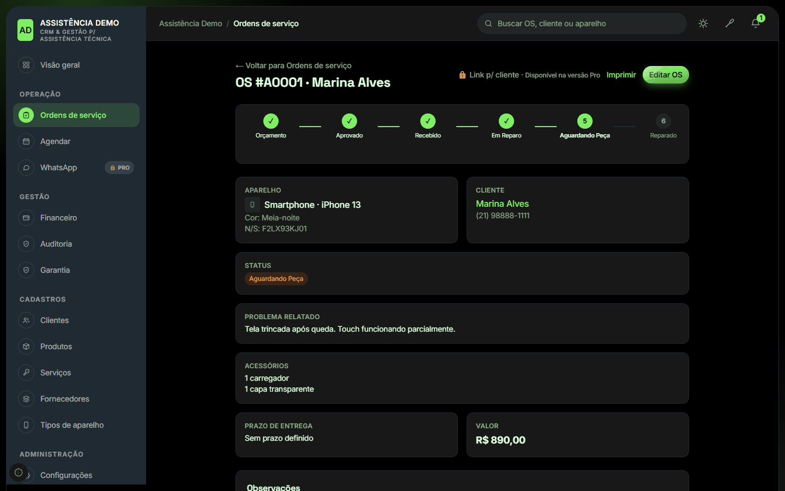
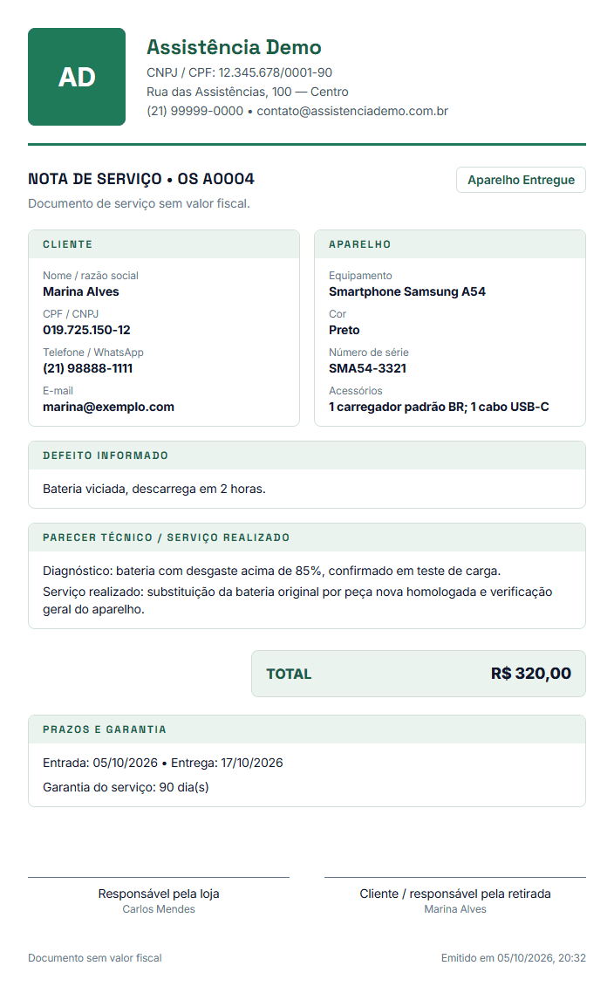
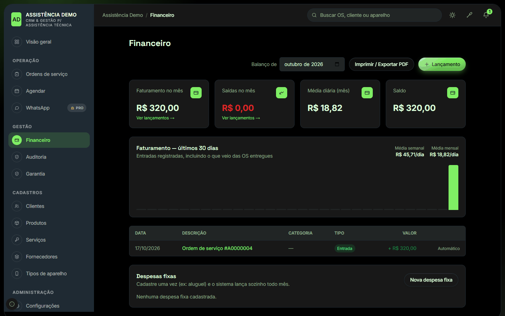
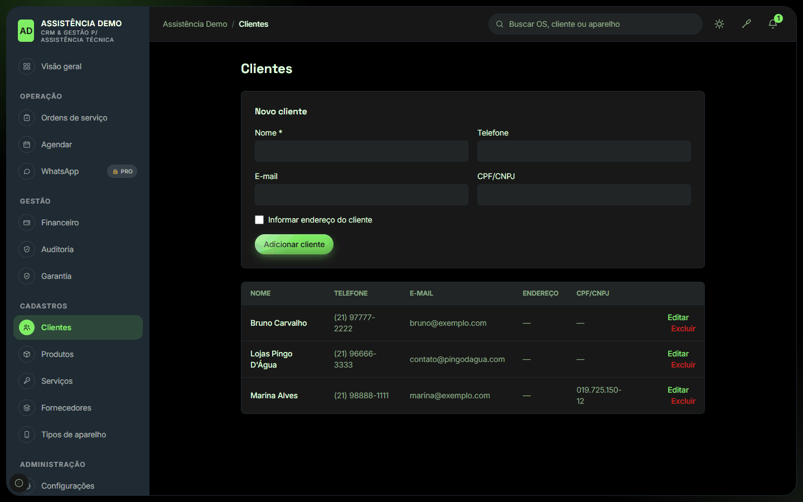
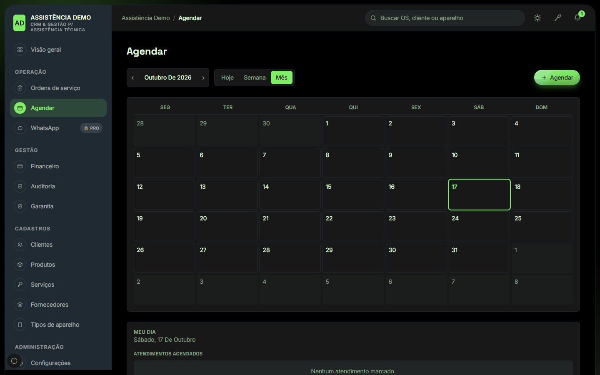
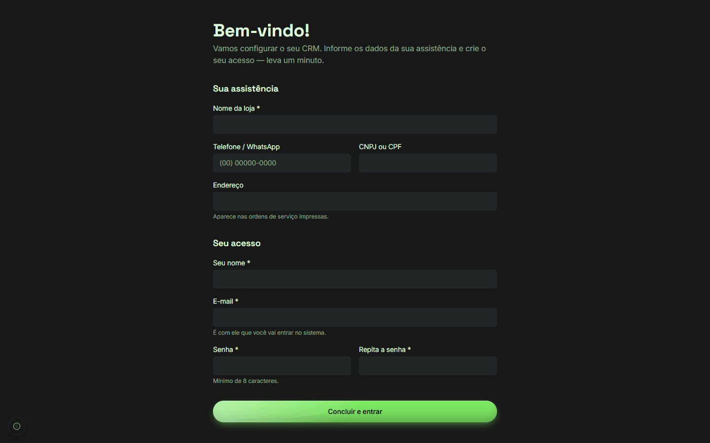

<p align="center">
  
</p>

<h1 align="center">BancadaSync</h1>
<p align="center"><b>Do check-in ao reparo entregue.</b><br>
O sistema de gestão para assistência técnica que roda no seu próprio computador. Grátis.</p>

<p align="center">
  <a href="https://github.com/vendashson-rgb/BancadaSync-Download/releases/latest/download/BancadaSync-Setup.exe"><b>⬇️ Baixar para Windows (85 MB)</b></a>
  &nbsp;·&nbsp;
  <a href="https://vendashson-rgb.github.io/BancadaSync-Download/">Ver a página com os prints</a>
</p>

---

## O problema

Em muita assistência técnica a operação vive em caderno, planilha e conversa de WhatsApp:
o aparelho chega e ninguém lembra o que veio junto, o cliente liga perguntando "ficou pronto?",
a peça foi pedida mas ninguém sabe qual OS está esperando, a garantia não está escrita em lugar
nenhum e, no fim do mês, não dá para saber quanto a loja realmente faturou.

O BancadaSync organiza esse ciclo inteiro em um só lugar: **check-in → orçamento → reparo → entrega → garantia → caixa**.

## O que ele resolve

| Dor do dia a dia | Como o BancadaSync resolve |
|---|---|
| "O que veio junto com o aparelho?" | A **ordem de serviço** registra cliente, aparelho, número de série, acessórios e o defeito informado já no balcão. |
| "Em que pé está esse conserto?" | Cada OS tem um **status** (orçamento, aprovado, recebido, em análise, aguardando peça, pronto, entregue), visível na lista e no painel. |
| "Qual OS está parada esperando peça?" | O **painel ao vivo** mostra os atendimentos ativos e as **pendências** (OS aguardando peças, prontas para retirada). |
| "O cliente diz que não assinou nada" | **Impressão profissional da OS** (nota de serviço sem valor fiscal) com dados da loja, itens, total, prazos, garantia e campo de assinatura. |
| "Qual era a garantia mesmo?" | **Termos de garantia** por tipo de serviço, impressos junto com a OS. |
| "Quanto entrou e quanto saiu?" | **Financeiro**: o que é entregue vira entrada automaticamente; saídas, despesas fixas, balanço do mês e exportação em PDF. |
| "Quanto pago de comissão?" | **Comissão por técnico**, calculada sobre os reparos entregues. |
| "Cadê o histórico desse cliente?" | **Cadastro de clientes** com todas as OS de cada um. |
| "Quem mexeu nisso?" | **Auditoria** e **permissões por função** (dono, administrador, atendente, técnico, coleta). |
| "E se a internet cair?" | Os dados ficam **no seu computador**. Sem mensalidade e sem depender de nuvem para trabalhar. |

Também inclui agenda de atendimentos, produtos e estoque, serviços, fornecedores e tipos de aparelho.

## Prints

<table>
  <tr>
    <td width="50%"><br><sub><b>Painel ao vivo</b>: atendimentos ativos, pendências e números do mês.</sub></td>
    <td width="50%"><br><sub><b>Ordens de serviço</b>: status de cada aparelho num relance.</sub></td>
  </tr>
  <tr>
    <td><br><sub><b>Detalhe da OS</b>: fluxo do reparo, aparelho, cliente e valores.</sub></td>
    <td><br><sub><b>OS impressa</b>: nota de serviço pronta para o cliente assinar.</sub></td>
  </tr>
  <tr>
    <td><br><sub><b>Financeiro</b>: faturamento, saídas, balanço mensal e despesas fixas.</sub></td>
    <td><br><sub><b>Clientes</b>: cadastro com o histórico de cada um.</sub></td>
  </tr>
  <tr>
    <td><br><sub><b>Agenda</b>: atendimentos do dia, da semana e do mês.</sub></td>
    <td><br><sub><b>Primeiro acesso</b>: crie a sua loja e o seu usuário em um minuto.</sub></td>
  </tr>
</table>

> Os prints usam dados fictícios (loja "Assistência Demo").

## Grátis e Pro

| | Grátis | Pro |
|---|:---:|:---:|
| Ordens de serviço, impressão e garantia | ✅ | ✅ |
| Clientes, equipamentos, produtos, serviços e fornecedores | ✅ | ✅ |
| Financeiro e comissões | ✅ | ✅ |
| Auditoria e permissões por função | ✅ | ✅ |
| Usuários | até 3 | ilimitados |
| Link de acompanhamento para o cliente | 🔒 | ✅ |
| WhatsApp integrado e modelos de mensagem | 🔒 | ✅ |
| Integração por API / N8N | 🔒 | ✅ |
| Acesso no desktop, tablet e celular | 🔒 | ✅ |
| Acompanhar a distância, em tempo real, quando a loja está faturando | 🔒 | ✅ |

A ativação do Pro é feita com o desenvolvedor: veja o contato no fim desta página.

## Como instalar

1. Baixe o **[BancadaSync-Setup.exe](https://github.com/vendashson-rgb/BancadaSync-Download/releases/latest/download/BancadaSync-Setup.exe)**.
2. Dê dois cliques. O Windows pode mostrar o aviso **"O Windows protegeu o computador"**: clique em **Mais informações** e depois em **Executar assim mesmo** (veja a pergunta frequente abaixo).
3. Siga o assistente. **Não precisa de senha de administrador.**
4. Abra o **BancadaSync** pelo atalho. O navegador abre na tela de primeiro acesso: informe os dados da loja e crie o seu usuário e senha.

Para desligar o sistema, use **Desligar o BancadaSync** no Menu Iniciar. Ao ligar o computador de novo, é só abrir o atalho: todos os seus dados e acessos voltam como estavam.

**Requisitos:** Windows 10 ou 11 de 64 bits e cerca de 350 MB livres.

## Perguntas frequentes

**Por que o Windows mostra um aviso ao instalar?**
O instalador ainda não tem assinatura digital paga (certificado de "editor verificado"), então o SmartScreen mostra "editor desconhecido". O arquivo é o mesmo publicado aqui: você pode conferir a integridade pelo hash abaixo.

**Onde ficam os meus dados?**
No seu computador, em `%APPDATA%\CRM Assistencia`. Ao desinstalar, o programa pergunta se você quer apagar os dados (o padrão é mantê-los).

**Preciso de internet?**
Para trabalhar no dia a dia, não. Só para os recursos que dependem dela (como o WhatsApp, na versão Pro).

**Posso atualizar por cima?**
Sim. Rode o instalador novo: ele desliga o sistema, troca os arquivos e mantém os seus dados.

**Confira o arquivo (SHA-256) do `BancadaSync-Setup.exe` da versão 1.0.0:**

```
1d10463c9d5ac24ce16623b04e5573c4cbf718de99053cb7d86f108681689fa7
```

No PowerShell: `Get-FileHash .\BancadaSync-Setup.exe -Algorithm SHA256`

## Contato

Desenvolvido por **Jefferson Honorio (MeoWDev MOD)**.

- WhatsApp: [+55 21 96654-7296](https://wa.me/5521966547296)
- Instagram: [@TECH_MEOW.OFICIAL](https://www.instagram.com/tech_meow.oficial?cplk=MWp5Z2s2cjNuNG01bg==)
- Site: [Tech MeoW](https://linktr.ee/tech_meow?utm_source=linktree_profile_share&ltsid=531414a6-986b-4891-a08f-9445b634b839)
- E-mail: vendas.hson@gmail.com

<p align="center"></p>
